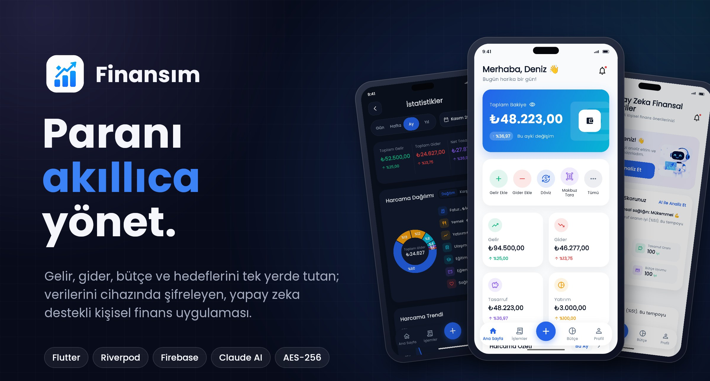
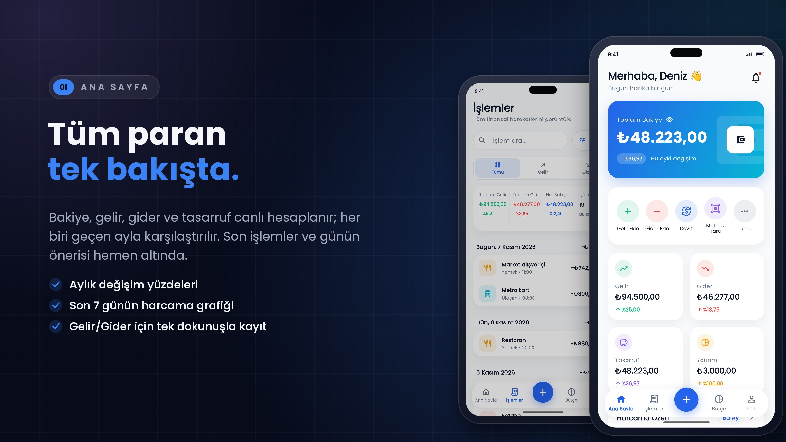
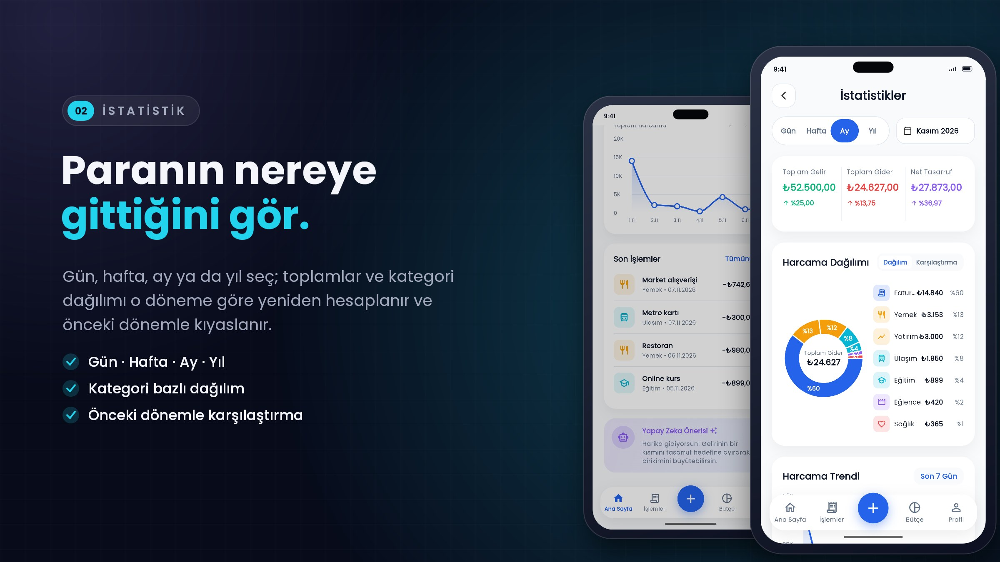
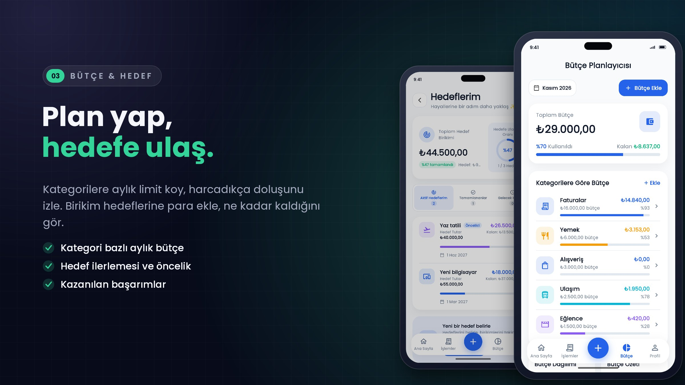
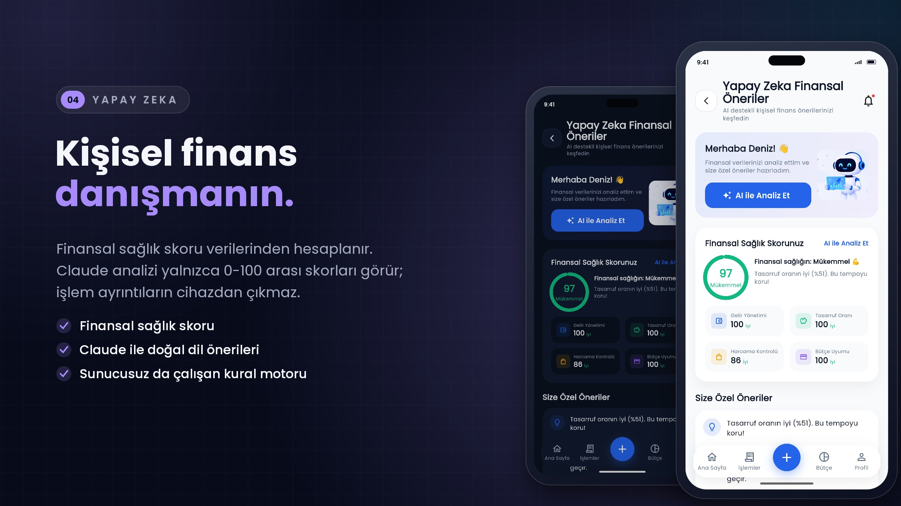
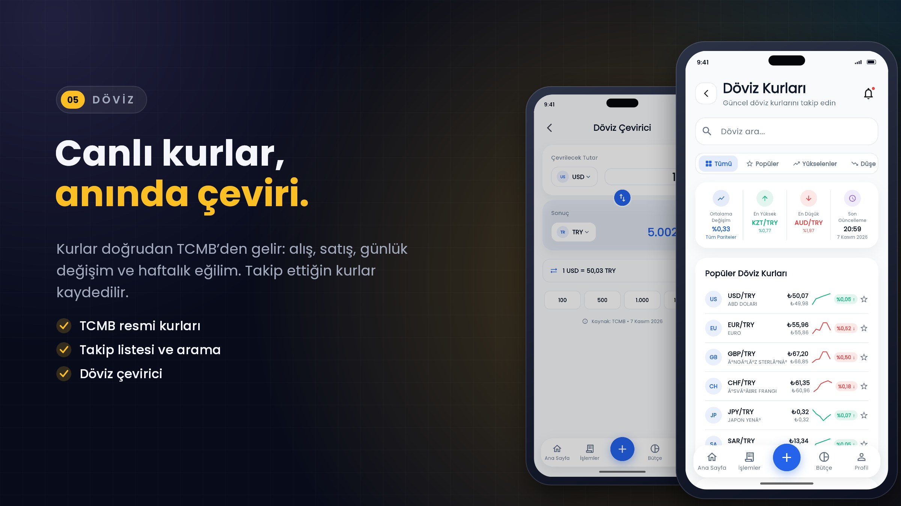
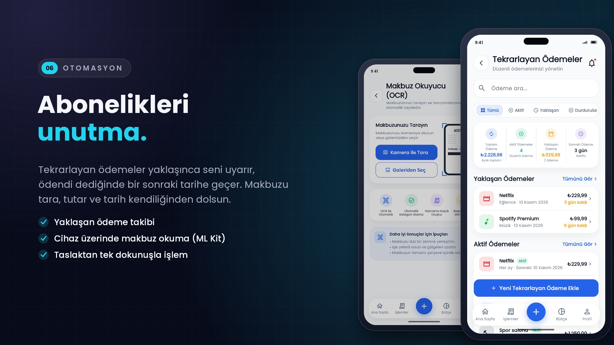
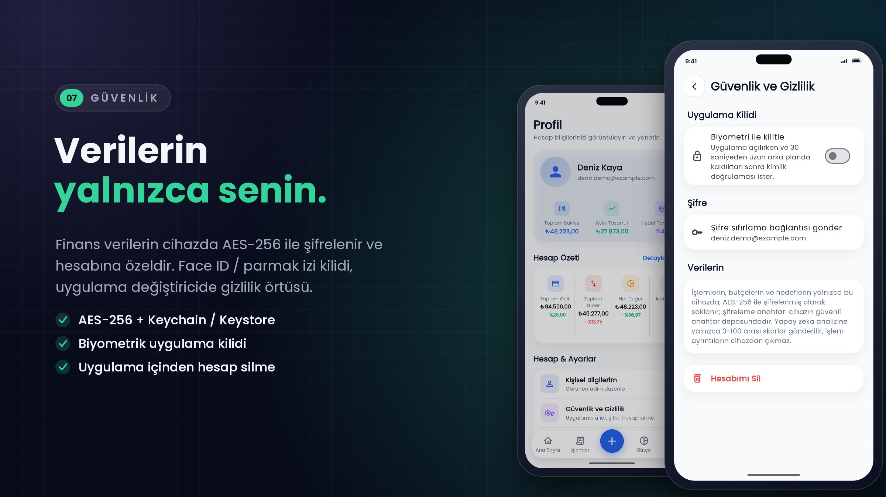
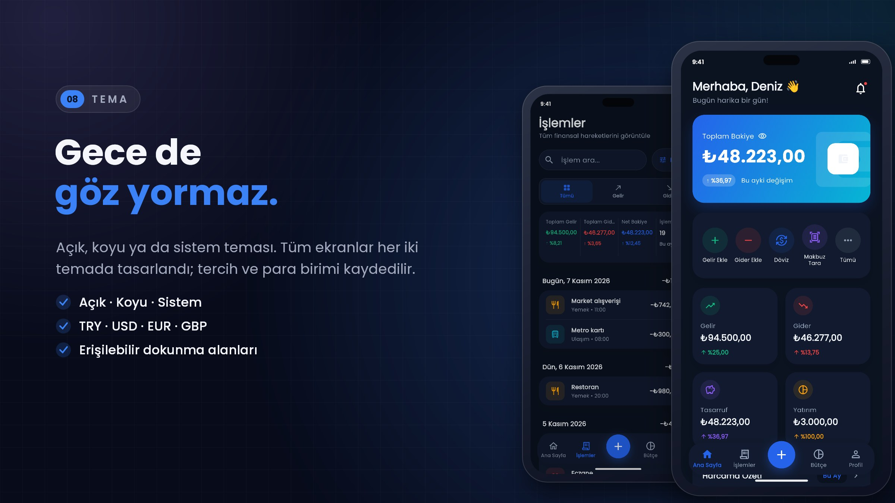
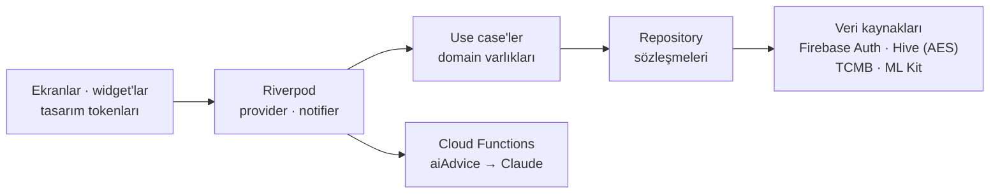

<div align="center">


# Finansım

<br>



<br>
<br>

Gelir, gider, bütçe ve birikim hedeflerini tek yerde toplayan; verilerini cihazında şifreleyen,<br>
canlı döviz kurları, makbuz okuma ve yapay zeka danışmanı sunan kişisel finans uygulaması.

<br>

[](https://github.com/geniuseyis/finansim/actions/workflows/ci.yml)


**[Ekranlar](#ekranlar)** &nbsp;·&nbsp; **[Mimari](#mimari)** &nbsp;·&nbsp; **[Başlarken](#başlarken)** &nbsp;·&nbsp; **[Güvenlik](#güvenlik-ve-gizlilik)** &nbsp;·&nbsp; **[Yol haritası](#yol-haritası)**

</div>

<br>

<table>
  <tr>
    <td width="50%" valign="top">
      <h4>🔐&nbsp; Verilerin cihazında</h4>
      İşlemler, bütçeler ve hedefler AES-256 ile şifrelenir; anahtar Keychain / Keystore'da durur ve her hesabın verisi ayrıdır.
    </td>
    <td width="50%" valign="top">
      <h4>📊&nbsp; Gerçek veriyle çalışır</h4>
      Her ekran kendi işlemlerinden hesaplanır: dönem filtreli istatistikler, bütçe doluluğu, hedef ilerlemesi.
    </td>
  </tr>
  <tr>
    <td width="50%" valign="top">
      <h4>🤖&nbsp; Yapay zeka danışmanı</h4>
      Finansal sağlık skoru ve Claude önerileri. Sunucuya yalnızca 0-100 arası skorlar gider, işlem ayrıntıları asla.
    </td>
    <td width="50%" valign="top">
      <h4>🍎&nbsp; Platforma uygun tasarım</h4>
      Apple HIG'e göre sekmeler, yerel diyaloglar, 44 pt dokunma alanları, VoiceOver etiketleri, açık ve koyu tema.
    </td>
  </tr>
</table>

<br>

## Ekranlar

<p align="center"></p>
<p align="center"></p>
<p align="center"></p>
<p align="center"></p>
<p align="center"></p>
<p align="center"></p>
<p align="center"></p>
<p align="center"></p>

<p align="center"><sub>Telefon ekranları, uygulamanın Android emülatöründe demo verilerle alınmış gerçek açık ve koyu tema görüntüleridir.</sub></p>

<details>
<summary><b>Tüm özellikler</b></summary>
<br>

| Alan | Özellikler |
| :-- | :-- |
| **Hesap** | E-posta/şifre, Google ve Apple ile giriş (Firebase Auth) · Anahtar Zinciri otomatik doldurma · şifre sıfırlama · görünen ad düzenleme · uygulama içinden hesap silme |
| **İşlemler** | Gelir/gider ekleme ve düzenleme · kategori, tarih, açıklama ve ödeme yöntemi · tarihe göre gruplama · arama ve gelişmiş filtre (tür, kategori, tarih, tutar, ödeme yöntemi) · sistem paylaşım menüsü |
| **Ana sayfa** | Bakiye ve aylık değişim · gelir, gider, tasarruf, yatırım kartları · son 7 günün harcama grafiği · son işlemler · günün önerisi |
| **İstatistikler** | Gün / Hafta / Ay / Yıl filtresi · önceki dönemle karşılaştırma · kategori dağılımı · harcama trendi |
| **Bütçe** | Kategori bazlı aylık limitler · kullanım yüzdesi ve kalan tutar · aşım uyarıları |
| **Hedefler** | Birikim hedefleri · katkı ekleme · öncelik · aktif / tamamlanan / gelecek sekmeleri |
| **Tekrarlayan ödemeler** | Haftalık, aylık, 3 aylık, yıllık · yaklaşan ödemeler · ödendi işaretleyince sonraki tarihe geçiş |
| **Döviz** | TCMB resmi kurları (alış, satış, değişim, haftalık eğilim) · takip listesi · döviz çevirici |
| **Makbuz okuyucu** | Kamera veya galeriden makbuz · cihaz üzerinde metin tanıma (Google ML Kit) · tutar, tarih, satıcı ile taslak işlem |
| **Yapay zeka** | Finansal sağlık skoru ve alt skorlar · kural tabanlı öneriler · Claude ile doğal dil analizi (Cloud Functions) |
| **Bildirimler** | Bütçe aşımı, yaklaşan ödeme ve hedef ilerlemesinden üretilen uyarılar |
| **Güvenlik** | AES-256 şifreli yerel veri · Face ID / Touch ID / parmak izi kilidi · uygulama değiştiricide gizlilik örtüsü · App Check |
| **Kişiselleştirme** | Açık / Koyu / Sistem teması · TRY, USD, EUR, GBP · hesaplanan başarımlar |

</details>

<br>

## Mimari

Özellik bazlı **Clean Architecture**: her özellik kendi `data`, `domain` ve `presentation` katmanını taşır. Arayüz yalnızca domain sözleşmelerini tanır; Firebase ve Hive ayrıntıları `data` katmanında kalır.



| Katman | Sorumluluk |
| :-- | :-- |
| **config** | Tasarım tokenları (renk, boşluk, radius, tipografi), açık/koyu tema, `go_router` yönlendirmesi |
| **core** | `SecureLocalStore` (şifreli, hesaba özel Hive kutuları), biyometri servisi, biçimlendiriciler, hata tipleri |
| **features/\*/domain** | Saf Dart varlıkları ve use case'ler (`AppTransaction`, `SavingsGoal`, `FinanceSummary`…) |
| **features/\*/data** | Firebase Auth, Hive, TCMB XML ve ML Kit uygulamaları; `Either<Failure, T>` dönüşümü |
| **features/\*/presentation** | Ekranlar, Riverpod provider'ları ve controller'lar |
| **functions/** | `aiAdvice`: oturum + App Check doğrulayan, günlük kotalı Claude proxy'si |

<details>
<summary><b>Teknoloji yığını</b></summary>
<br>

| Alan | Teknoloji |
| :-- | :-- |
| Dil ve çatı | Dart 3.11, Flutter 3.41 |
| Durum yönetimi | Riverpod 3 (`Notifier`, `AsyncNotifier`, `StreamProvider`) |
| Yönlendirme | go_router |
| Yerel veri | Hive + `HiveAesCipher`, anahtar `flutter_secure_storage` ile |
| Kimlik | Firebase Auth (e-posta, Google, Apple), Firebase App Check |
| Sunucu | Cloud Functions (Node 22), Secret Manager, Firestore (kota sayacı) |
| Yapay zeka | Anthropic Claude (`@anthropic-ai/sdk`) |
| Grafik | fl_chart |
| Diğer | local_auth, google_mlkit_text_recognition, image_picker, share_plus, http + xml |
| Test ve CI | flutter_test, GitHub Actions |

</details>

<details>
<summary><b>Proje yapısı</b></summary>
<br>

```text
.
├── lib/
│   ├── config/              # tema, tasarım tokenları, rotalar
│   ├── core/                # güvenli depolama, servisler, yardımcılar
│   ├── shared/widgets/      # AppCard, AppBackButton, onay diyaloğu…
│   └── features/
│       ├── auth/            # giriş, kayıt, uygulama kilidi
│       ├── dashboard/       # ana sayfa
│       ├── transactions/    # işlemler, filtre, detay, düzenleme
│       ├── statistics/      # dönem bazlı istatistikler
│       ├── budget/ · goals/ · recurring/
│       ├── currency/        # TCMB kurları ve çevirici
│       ├── ocr/             # makbuz okuyucu
│       ├── ai_advisor/      # sağlık skoru ve Claude analizi
│       └── settings/ · profile/ · notifications/ · categories/
├── functions/               # Cloud Functions (aiAdvice)
├── test/                    # birim testleri
├── android/ · ios/          # platform projeleri
├── firestore.rules          # istemciye kapalı kurallar
└── scripts/                 # yardımcı betikler
```

</details>

<br>

## Başlarken

> **Gereksinimler:** Flutter 3.41+ (Dart 3.11), Android Studio veya Xcode, Firebase CLI

**1 · Bağımlılıklar ve çalıştırma**

```bash
flutter pub get
flutter run
```

Firebase yapılandırması (`lib/firebase_options.dart`) depoda hazır. Kendi projeni kullanmak için `flutterfire configure` çalıştır.

**2 · Yapay zeka analizi** <sub>(isteğe bağlı)</sub>

Fonksiyon kurulmadan da uygulama tam çalışır; AI danışmanı cihazdaki kural tabanlı önerileri gösterir. Claude analizini açmak için (Blaze planı gerekir):

```powershell
cd functions; npm ci; cd ..
powershell -ExecutionPolicy Bypass -File scripts\set-ai-key.ps1   # anahtarı gizli olarak sorar
firebase deploy --only functions,firestore:rules
```

**3 · Android release imzası** <sub>(isteğe bağlı)</sub>

`android/key.properties` dosyasına `storeFile`, `storePassword`, `keyAlias`, `keyPassword` yaz; dosya yoksa debug anahtarıyla imzalanır.

**4 · Mağaza sürümü**

```bash
flutter build appbundle --release --obfuscate --split-debug-info=build/symbols
```

`build/symbols` klasörünü sakla; çökme raporlarını okunur hale getirmek için gerekir.

> [!NOTE]
> Geliştirme sürümü App Check debug sağlayıcısını kullanır. Cihazın debug token'ını Firebase Console → App Check → **Manage debug tokens** bölümüne eklemen gerekir; aksi halde AI fonksiyonu istekleri reddeder.

<br>

## Test ve CI

```bash
flutter analyze   # statik analiz
flutter test      # 31 birim testi
```

| Dosya | Kapsam |
| :-- | :-- |
| `finance_summary_period_test` | Dönem aralıkları, dönem bazlı toplamlar, önceki dönemle değişim |
| `transaction_filter_test` | Tür, kategori, tarih, tutar, ödeme yöntemi ve arama filtreleri |
| `transaction_model_test` | Hive Map dönüşümü, eski kayıtlarla uyumluluk |
| `savings_goal_test` · `formatters_test` · `validators_test` | Hedef hesapları, para/tarih biçimleri, form doğrulama |

Her push'ta **GitHub Actions** analiz ve testleri çalıştırır, web sürümünü derler ve bulut fonksiyonunun bağımlılıklarını `npm audit` ile denetler.

<br>

## Güvenlik ve gizlilik

- Finans verileri yalnızca cihazda, **AES-256** ile şifreli ve hesaba özel tutulur; Android yedeğine dahil edilmez.
- **Claude API anahtarı uygulamaya girmez**; Cloud Functions'ta Secret Manager'da durur. Fonksiyon oturum ve App Check ister, kullanıcı başına günde 10 analizle sınırlıdır.
- İsteğe bağlı **biyometrik kilit**; uygulama değiştiricide bakiyeler gizlenir.
- Hesap, uygulama içinden kimlik yeniden doğrulanarak silinir; yerel veri de temizlenir.

Ayrıntılar ve Firebase Console'da yapılması gerekenler: **[SECURITY.md](SECURITY.md)**

<br>

## Tasarım ilkeleri

| İlke | Uygulama |
| :-- | :-- |
| **Yalnızca gerçek veri** | Hiçbir ekranda örnek ya da uydurma rakam yok; işlevi olmayan buton bırakılmadı |
| **Sekme, yığın değil** | Alt çubuk bölümler arasında geçiş yapar; kök ekranlarda geri butonu yok |
| **Erişilebilir dokunma** | En az 44 pt hedefler, VoiceOver etiketleri, "Hareketi Azalt" desteği |
| **Platforma uygun** | iOS'ta Cupertino uyarı ve eylem sayfaları, Android'de Material karşılıkları |
| **Tek tasarım sistemi** | Renk, boşluk ve radius yalnızca tokenlardan; açık ve koyu tema aynı bileşenlerle |

<br>

## Yol haritası

- [x] Clean Architecture, Riverpod ve gerçek veriyle çalışan 25+ ekran
- [x] Şifreli, hesaba özel yerel veri ve biyometrik kilit
- [x] Claude danışmanı için güvenli Cloud Functions proxy'si
- [x] Apple HIG düzenlemesi, açık ve koyu tema
- [ ] Firestore ile cihazlar arası senkronizasyon
- [ ] Fiziksel iPhone testi ve TestFlight
- [ ] Google Play ve App Store yayını

<br>

<div align="center">
<sub>© 2026 Finansım · Tüm hakları saklıdır.</sub>
</div>
